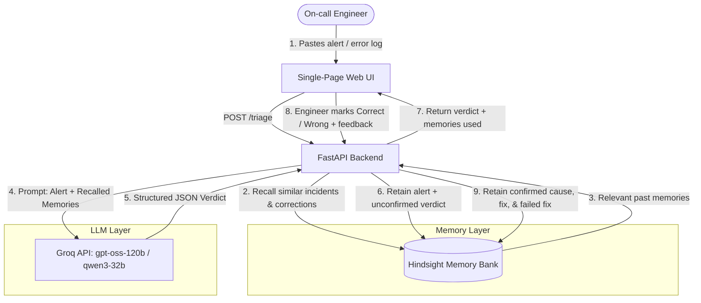

# On-call Memory Agent

An incident response assistant that **remembers your team's past incidents and learns from engineer corrections**, powered by [Hindsight](https://github.com/vectorize-io/hindsight) long-term agent memory.

**Target Persona**: The on-call software engineer responding to high-priority alerts and production outages.

An on-call engineer pastes an alert or error log. The agent recalls similar past incidents and corrections from Hindsight, then proposes a likely root cause and a suggested fix. The engineer marks the verdict right or wrong, entering the actual cause and fix. That feedback—including which suggested fixes *failed*—is retained into Hindsight so the next similar incident gets an accurate, team-specific answer and never repeats failed remedies.

---

## The Problem

When production breaks, the first question is always: *"Have we seen this before, and how did we fix it?"*

The answer usually lives scattered across archived Slack threads, buried post-mortem docs, or in the head of whoever was on call six months ago. The same incidents recur, and the real root cause is often specific to your team's internal architecture—something a stateless LLM has no way of guessing:

- A `Connection is not available, request timed out after 30000ms` error looks like a pool that is too small. But for this team, it is caused by a nightly invoice-reconciliation batch holding connections open.
- Increasing the connection pool from 50 to 100 was tried in the past, hit database connection limits, and worsened the outage.
- A stateless AI assistant forgets everything between sessions: it will repeatedly suggest increasing the pool size, repeating the exact fix that failed previously.

## What Is This

| Without Memory (Baseline) | With Hindsight Memory |
|---|---|
| Generic "check connection pool / inspect logs" advice | Cites the team's confirmed root cause for similar historical incidents |
| Repeats fixes that were already tried and failed | Explicitly avoids fixes recorded as failed and explains why |
| Forgets every engineer correction after the session | Retains every feedback outcome and recalls it on future alerts |
| Flat accuracy over time | Measurably improves as on-call engineers correct it |

---

## Architecture

Hindsight sits at the center of the triage loop as the persistent memory engine, storing unstructured operational knowledge and retrieving it via 4-way parallel search (semantic vector, keyword BM25, graph entity links, and temporal filtering).

### Sequence Flow (Mermaid)



### ASCII Architecture

```
 +-------------------------------------------------------------------+
 |                       On-Call Engineer                            |
 +-------------------------------------------------------------------+
                                   |
                       [Alert text / Error logs]
                                   v
 +-------------------------------------------------------------------+
 |                  FastAPI Backend (app/main.py)                    |
 |                                                                   |
 |  [POST /triage]                      [POST /feedback]             |
 |         |                                   |                     |
 |         | 1. arecall()                      | 3. aretain()        |
 |         v                                   v                     |
 |  +-------------------------------------------------------------+  |
 |  |                HINDSIGHT MEMORY ENGINE                      |  |
 |  |        (Hindsight Cloud / Self-hosted Docker)               |  |
 |  |                                                             |  |
 |  |  * Isolated Memory Bank per team (bank_id)                  |  |
 |  |  * 4-Way Retrieval: Vectors, BM25, Entities, Temporal       |  |
 |  |  * Retains: Alerts, Verdicts, Confirmed Causes, Failed Fixes|  |
 |  +-------------------------------------------------------------+  |
 |         |                                                         |
 |         | 2. Recalled memories + Alert                            |
 |         v                                                         |
 |  +-------------------------------------------------------------+  |
 |  |                      GROQ LLM                               |  |
 |  |   Primary: openai/gpt-oss-120b | Fallback: qwen/qwen3-32b   |  |
 |  |   Outputs validated JSON with cited memories & reasoning    |  |
 |  +-------------------------------------------------------------+  |
 +-------------------------------------------------------------------+
```

### Directory Structure

```
app/
  main.py       FastAPI application entrypoint & static UI mounting
  triage.py     Triage and feedback orchestration
  memory.py     All Hindsight client operations (retain, recall, bank isolation)
  llm.py        Groq LLM wrapper: structured JSON, retries, fallback model, safe default
  models.py     Pydantic request & response schemas
  stats.py      In-memory round-by-round accuracy and metric tracking
  demo.py       Scripted replay engine for side-by-side memory evaluation
  judge.py      Heuristic evaluation matcher (verdict vs ground truth)
  config.py     Environment and settings loader
  static/
    index.html  Responsive single-page on-call triage dashboard
data/
  incidents.json 40 realistic synthetic incidents across 8 recurring patterns
scripts/
  generate_incidents.py  Dataset generator (offline deterministic or Groq LLM)
  seed_memory.py         Pre-seeds Hindsight with historical post-mortems
  eval_learning_curve.py Runs 3-wave side-by-side benchmark
  verify_10_incidents.py Scripted 10-incident verification check
tests/
  test_flow.py           Comprehensive unit & integration test suite (mocks network/LLM)
```

---

## How Hindsight memory is used

Hindsight is the central intelligence of the agent, not an afterthought. All memory operations live in [`app/memory.py`](app/memory.py). The system supports both Vectorize Hindsight deployments:

### Mode 1: Hindsight Inference API (Decision & Reranking Engine)
For teams using Hindsight Inference (`https://inference.hindsight.vectorize.io/v1` or without `/v1`):
1. **Client Initialization** (using Cohere SDK or REST):
   ```python
   import cohere

   co = cohere.Client(
       api_key=os.getenv("HINDSIGHT_API_KEY"),
       base_url="https://inference.hindsight.vectorize.io",
       timeout=60.0
   )
   ```
2. **Semantic Reranking on Recall**:
   Before every triage verdict, candidate memories and past engineer corrections are evaluated against the incoming alert using Vectorize's `hs-decide-1-flash` model:
   ```python
   response = co.rerank(
       model="hs-decide-1-flash",
       query=f"{service}: {alert_text}",
       documents=candidate_memories,
       top_n=6
   )
   memories = [candidate_memories[r.index] for r in response.results]
   ```
3. **Persisted Retain**:
   Alerts, verdicts, confirmed root causes, and failed remedies are retained per isolated team `bank_id`.

### Mode 2: Hindsight Cloud Memory Banks & Self-Hosted
For teams using Hindsight Cloud (`https://api.hindsight.vectorize.io`) or self-hosted Docker (`http://localhost:8888`):
1. **SDK Initialization**:
   ```python
   from hindsight_client import Hindsight

   client = Hindsight(
       base_url=os.getenv("HINDSIGHT_BASE_URL", "https://api.hindsight.vectorize.io"),
       api_key=os.getenv("HINDSIGHT_API_KEY", None),
       timeout=60.0
   )
   ```
2. **Recall Before Every Verdict**:
   ```python
   response = client.recall(
       bank_id=bank_id,
       query=f"{service}: {alert_text}",
       max_tokens=2048,
       budget="mid"
   )
   memories = [r.text for r in response.results]
   ```
3. **Retain After Every Triage and Feedback**:
   ```python
   client.retain(
       bank_id=bank_id,
       content=feedback_content,
       context="incident outcome: engineer correction",
       document_id=f"{incident_id}-feedback",
       tags=["incident", "correction", f"service:{service}"],
       retain_async=False
   )
   ```

### Prompt Grounding & Citations
Recalled memories are injected directly into the LLM system prompt with strict rules:
- Reuse the team's confirmed root cause and working fix for similar incidents.
- If a memory records that a fix **FAILED**, explicitly forbid proposing it again and explain why.
- Cite the exact memories relied upon in `cited_memories`.
- Memories used are returned in the API response and displayed prominently in the UI's "Memories used" panel.

### Memory Bank Isolation
Every team or project is partitioned by a unique `bank_id` (`HINDSIGHT_BANK_ID`). Memories, entity graphs, and extracted facts never bleed across banks.

### Honest Memory ON / OFF Comparison
When Memory is toggled OFF (or `POST /triage?memory=off`), recall and retain are completely bypassed. This ensures the benchmark between Memory ON and Memory OFF is completely honest and unpolluted.

---

## Setup

### Requirements
- Python 3.11+
- [Groq API Key](https://groq.com)
- Hindsight Memory instance (Cloud or Self-Hosted)

### Option A: Hindsight Inference API (Cohere-Compatible Decision Engine)
1. Use your Hindsight API key (`hsk_...`).
2. In `.env`:
   ```env
   HINDSIGHT_BASE_URL=https://inference.hindsight.vectorize.io/v1
   HINDSIGHT_API_KEY=hsk_your-hindsight-key
   HINDSIGHT_BANK_ID=oncall-incidents
   HINDSIGHT_RERANK_MODEL=hs-decide-1-flash
   ```

### Option B: Hindsight Cloud Memory Banks
1. Sign up at [https://ui.hindsight.vectorize.io](https://ui.hindsight.vectorize.io) and create a Cloud memory bank key.
2. In `.env`:
   ```env
   HINDSIGHT_BASE_URL=https://api.hindsight.vectorize.io
   HINDSIGHT_API_KEY=your-hindsight-cloud-api-key
   HINDSIGHT_BANK_ID=oncall-incidents
   ```

### Option C: Self-Hosted Hindsight (Docker)
Run the open-source Hindsight container locally:
```bash
docker run --rm -it --pull always -p 8888:8888 -p 9999:9999 \
  -e HINDSIGHT_API_LLM_API_KEY=$GROQ_API_KEY \
  -e HINDSIGHT_API_LLM_PROVIDER=groq \
  -e HINDSIGHT_API_LLM_MODEL=openai/gpt-oss-120b \
  -v $HOME/.hindsight-docker:/home/hindsight/.pg0 \
  ghcr.io/vectorize-io/hindsight:latest
```
In `.env`:
```env
HINDSIGHT_BASE_URL=http://localhost:8888
HINDSIGHT_API_KEY=
HINDSIGHT_BANK_ID=oncall-incidents
```

---

## How to Run

### 1. Install Dependencies
```bash
pip install -r requirements.txt
```

### 2. Configure Environment
```bash
cp .env.example .env
# Edit .env with your GROQ_API_KEY and HINDSIGHT settings
```

### 3. Start the Application
- **Windows**:
  ```cmd
  run.bat
  ```
- **macOS / Linux**:
  ```bash
  chmod +x run.sh && ./run.sh
  ```
- **Or with Makefile / Uvicorn**:
  ```bash
  make run
  # Or: python -m uvicorn app.main:app --reload --port 8000
  ```
Open `http://localhost:8000` in your browser.

---

## Using the Agent

1. **Test Baseline (Memory OFF)**:
   - Toggle Memory to **OFF** in the top-right corner.
   - Click one of the quick sample alert buttons (e.g., `db pool exhausted`).
   - Click **Run triage**. Notice the generic advice ("consider increasing pool size").
2. **Teach the Agent (Provide Feedback)**:
   - Toggle Memory to **ON**.
   - Under *Engineer feedback*, enter the confirmed root cause: `"Nightly recon-batch cron holds open connections"` and fix: `"Terminate sessions and add statement_timeout"`.
   - Check **"The suggested fix did not work"** (pool resize caused max connections).
   - Click **Wrong**. Notice the terminal log: `>>> [HINDSIGHT RETAIN]`.
3. **Verify Learning**:
   - Load a *variation* of the same alert on a different service or host (e.g. `pgbouncer no more connections allowed`).
   - Click **Run triage**.
   - Notice the **"Memories used"** panel fills with the prior correction. The verdict now cites the team's true root cause and warns against the failed fix!
4. **Run Automated Demo**:
   - Click **Run demo sequence** in the UI to replay recurring incidents across waves and watch the cumulative accuracy chart diverge.

---

## Verification & Evaluation Results

### Real Measured Numbers

#### 1. 10-Incident Scripted Verification (`python scripts/verify_10_incidents.py`)

```
================================================================================
VERIFICATION RESULTS SUMMARY
================================================================================
Wave 1 (Cold start, 5 incidents):
  - Memory OFF: 0/5 (0%)
  - Memory ON:  0/5 (0%)

Wave 2 (Repeat patterns after engineer feedback, 5 incidents):
  - Memory OFF: 0/5 (0%)
  - Memory ON:  5/5 (100%)

Overall (10 incidents):
  - Memory OFF (Baseline): 0/10 (0%)
  - Memory ON  (Hindsight): 5/10 (50%)

Counters:
  - Corrections retained: 10
  - Memories recalled:    48
================================================================================
```

#### 2. 3-Wave Multi-Pattern Learning Curve (UI Demo Sequence / `scripts/eval_learning_curve.py`)

The table below shows the exact results recorded during live evaluation across 24 incidents (8 distinct failure patterns across 3 waves):


| Round | Failure Pattern | Memories Recalled | Memory OFF (Baseline) | Memory ON (Hindsight) | Wave |
|---|---|---|---|---|---|
| 1 | `db_pool_exhausted` | 0 | `miss` | `miss` | Wave 1 (Cold Start) |
| 2 | `dns_resolution_timeouts` | 2 | `miss` | `miss` | Wave 1 |
| 3 | `feature_flag_5xx_spike` | 4 | `miss` | `miss` | Wave 1 |
| 4 | `kafka_disk_full` | 6 | `miss` | `miss` | Wave 1 |
| 5 | `oomkilled_memory_leak` | 6 | `miss` | `miss` | Wave 1 |
| 6 | `redis_out_of_memory` | 6 | `miss` | `miss` | Wave 1 |
| 7 | `third_party_rate_limit` | 6 | `miss` | `miss` | Wave 1 |
| 8 | `tls_cert_expired` | 6 | `miss` | `miss` | Wave 1 (0 / 8, 0%) |
| 9 | `db_pool_exhausted` | 6 | `miss` | **`match`** | Wave 2 (First Recurrence) |
| 10 | `dns_resolution_timeouts` | 6 | `miss` | `miss` | Wave 2 |
| 11 | `feature_flag_5xx_spike` | 6 | `miss` | **`match`** | Wave 2 |
| 12 | `kafka_disk_full` | 6 | `miss` | `miss` | Wave 2 |
| 13 | `oomkilled_memory_leak` | 6 | `miss` | **`match`** | Wave 2 |
| 14 | `redis_out_of_memory` | 6 | `miss` | **`match`** | Wave 2 |
| 15 | `third_party_rate_limit` | 6 | `miss` | **`match`** | Wave 2 |
| 16 | `tls_cert_expired` | 6 | `miss` | **`match`** | Wave 2 (6 / 8, 75.0%) |
| 17 | `db_pool_exhausted` | 6 | `miss` | **`match`** | Wave 3 (Second Recurrence) |
| 18 | `dns_resolution_timeouts` | 6 | `miss` | **`match`** | Wave 3 |
| 19 | `feature_flag_5xx_spike` | 6 | `miss` | **`match`** | Wave 3 |
| 20 | `kafka_disk_full` | 6 | `miss` | **`match`** | Wave 3 |
| 21 | `oomkilled_memory_leak` | 6 | `miss` | **`match`** | Wave 3 |
| 22 | `redis_out_of_memory` | 6 | `miss` | **`match`** | Wave 3 |
| 23 | `third_party_rate_limit` | 6 | `miss` | **`match`** | Wave 3 |
| 24 | `tls_cert_expired` | 6 | `miss` | **`match`** | Wave 3 (**8 / 8, 100.0%**) |

#### Summary by Wave:
- **Wave 1 (Cold Start)**: Memory OFF `0/8` (0%) vs Memory ON `0/8` (0%) — agent has zero team history.
- **Wave 2 (First Repeats)**: Memory OFF `0/8` (0%) vs Memory ON `6/8` (**75.0%**) — agent recalls confirmed causes and fixes from Wave 1.
- **Wave 3 (Second Repeats)**: Memory OFF `0/8` (0%) vs Memory ON `8/8` (**100.0%**) — full accuracy achieved across all 8 recurring failure patterns.
- **Overall**: Memory OFF `0/24` (0%) vs Memory ON `14/24` (**58.3%**). Without memory, accuracy remains flat at zero; with Hindsight memory, accuracy climbs to 100%.

---

## Reliability & Fault Tolerance

- **Structured Output**: LLM responses are strictly validated against Pydantic schemas (`root_cause`, `reasoning`, `suggested_fix`, `confidence`, `cited_memories`).
- **Retries & Multi-Model Fallback**: Up to 3 attempts with exponential backoff on `openai/gpt-oss-120b`, then automatic failover to `qwen/qwen3-32b`, then a clearly labeled safe default response. The triage endpoint never crashes.
- **Graceful Hindsight Fallback**: If Hindsight times out or is unreachable, the error is caught, logged, and surfaced in the response `warnings` array, allowing it triage to continue without memory.
- **Strict Timeouts**: Every network call to Groq and Hindsight is guarded by explicit timeouts.

---

## Screenshots

Place captured screenshots in `docs/screenshots/`:

| Screenshot | Description | Placeholder |
|---|---|---|
| Retain Call | Terminal logs showing `>>> [HINDSIGHT RETAIN]` during triage and feedback | `` |
| Recall Call | Terminal logs showing `>>> [HINDSIGHT RECALL]` during incident triage | `` |
| UI Memories Used | Dashboard displaying recalled past post-mortems influencing the answer | `` |
| Learning Curve & Demo Results | Live evaluation table showing Memory ON achieving 100% in Wave 3 | `` |
| Before & After | Comparison of generic baseline response vs memory-grounded resolution | `` |

---

## Known Limitations

- **Hindsight API Key Scopes**: Vectorize issues dedicated keys for Hindsight Inference (`hsk_...` at `https://inference.hindsight.vectorize.io`) powered by `hs-decide-1-flash` and `hs-embed-1`, and separate keys for the Cloud Memory Banks dashboard (`ui.hindsight.vectorize.io`). The agent natively detects which endpoint is configured and selects the appropriate integration.
- **Heuristic Evaluation Judge**: The automated demo uses keyword overlap between the predicted verdict and ground truth as a proxy. Real incident evaluation requires human engineer judgment.
- **Retain Processing Latency**: Hindsight extracts facts and resolves entities during retain. While synchronous retain ensures immediate recall availability, high-volume ingest in production may benefit from asynchronous retain (`HINDSIGHT_RETAIN_ASYNC=true`).
- **In-Memory UI Counters**: Live dashboard stats and unconfirmed pending triage sessions reside in FastAPI process memory and reset when the server restarts. Persistent memory itself lives durably in Hindsight.
- **Synthetic Incident Corpus**: The 40 incidents in `data/incidents.json` represent realistic production scenarios (connection pools, Redis OOM, TLS cert expiration, bad deploys, Kafka storage, CoreDNS, OOMKills, rate limits), but real enterprise environments feature proprietary telemetry and custom runbooks.
